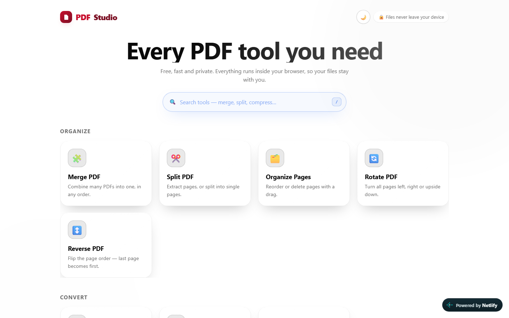
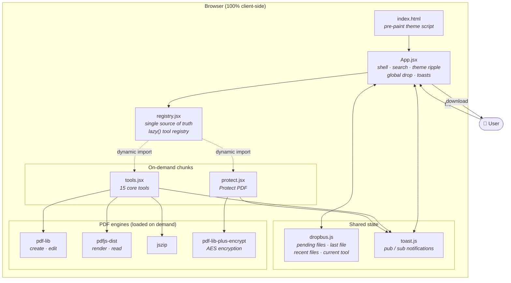

<div align="center">

# 📄 PDF Studio

**Every PDF tool you need — free, fast and private.**
Runs entirely in the browser. Your files never leave your device.

[](https://pdfstudio-free.netlify.app)
[](https://app.netlify.com/start/deploy?repository=https://github.com/shivamkr8135/pdfstudio-free)
[](https://react.dev)
[](https://vite.dev)
[](#license)

</div>

---

## 📸 Preview



---

## ✨ What it does

**18 tools, zero uploads, zero sign-up.**

| Group | Tools |
| --- | --- |
| **Organize** | Merge PDF · Split PDF · Organize Pages · Rotate PDF · Reverse PDF |
| **Convert** | Images to PDF · PDF to Images · PDF to Text |
| **Edit & Optimize** | Add Watermark · Page Numbers · Crop PDF · Add Image / Sign · Compress PDF · Resize to KB |
| **Advanced** | Edit Details (metadata) · **Protect PDF** (password + permissions) |

### 🔐 Protect PDF
The only tool that writes a *real* encrypted PDF (AES‑128) with a user password, an owner password and per‑permission flags (printing / copying / editing / annotating / form‑filling / page assembly). Everything is encrypted in the browser with `pdf-lib-plus-encrypt`.

---

## 💎 Premium experience

| Feature | What it does |
| --- | --- |
| 🌗 **Liquid‑glass search** | Translucent, blurred glass pill — gold in dark theme, blue in light theme |
| 🔁 **Ripple theme switch** | A circle grows from the toggle, covers the screen (~1 s) and flips the theme |
| ⌨️ **Command‑style search** | Press `/` to jump, `Esc` to clear, live result counter |
| 🎯 **Real progress** | Every tool shows a live % with a premium ring loader and a smooth minimum‑duration transition |
| 📥 **Drop anywhere** | Drag a file onto the page — the right tool opens automatically with the file loaded |
| 🕘 **Recent files** | Last 8 files remembered locally, one click back into the tool |
| 🔔 **Toasts** | Non‑blocking confirmations, no popups |
| ↩️ **Restore last file** | Reopen the file you just worked on, without browsing again |
| 🖼️ **Inline thumbnails** | Image previews inside the file list |
| 📜 **Scroll progress** | Gold bar in dark theme, blue in light theme |
| 📱 **Mobile‑first** | No tap‑highlight flash, no accidental text selection, safe‑area aware |
| ⚡ **Fast by design** | Tools and heavy PDF libraries load **on demand** — first paint is ~85 KB gzipped |

---

## 🧱 Architecture



### Why this shape?

- **`registry.jsx` is the single source of truth** — adding a tool means adding one line, and the home page, search, groups and routing update themselves.
- **`React.lazy` + dynamic `import()`** keeps `pdf-lib`, `pdf.js` and `jszip` out of the initial bundle. The home page ships React + CSS only; the PDF engines arrive when a tool is actually opened.
- **`dropbus.js`** is the bridge between the app shell and the lazy tool chunks: a file dropped on the page is parked in a module variable and picked up by whichever tool mounts next.
- **No backend, ever.** Files are read with `FileReader` / `ArrayBuffer` and written back with `Blob` + `URL.createObjectURL`.

---

## 📁 Project structure

```text
pdf-tools/
├── docs/
│   └── screenshot.png          # README preview
├── public/
│   ├── favicon.svg
│   ├── icons.svg
│   └── manifest.webmanifest    # PWA manifest
├── src/
│   ├── App.jsx                 # app shell: theme, search, routing, global drop, toasts
│   ├── App.css                 # the whole design system (monochrome + theme tokens)
│   ├── index.css               # global resets, tap-highlight & selection rules
│   ├── main.jsx                # React root + scroll restoration
│   ├── registry.jsx            # tool registry (lazy components)
│   ├── tools.jsx               # 15 core PDF tools + shared UI primitives
│   ├── protect.jsx             # Protect PDF (password + permissions)
│   ├── dropbus.js              # cross-module file/recent/tooltip bridge
│   ├── toast.js                # tiny toast pub/sub
│   └── assets/
├── index.html                  # app shell + pre-paint theme script
├── vite.config.js              # vendor chunk splitting
├── netlify.toml                # Netlify build + cache headers
├── eslint.config.js
└── package.json
```

---

## 🚀 Run it locally

```bash
git clone https://github.com/shivamkr8135/pdfstudio-free.git
cd pdfstudio-free
npm install
npm run dev      # http://localhost:5173
```

| Script | What it does |
| --- | --- |
| `npm run dev` | Vite dev server with HMR |
| `npm run build` | Production build into `dist/` |
| `npm run preview` | Serve the production build locally |
| `npm run lint` | ESLint (React Compiler rules included) |

---

## ☁️ Deploy on Netlify

The repo is deploy‑ready — `netlify.toml` sets the build command, publish directory and long‑cache headers for hashed assets.

```bash
npm i -g netlify-cli
netlify login
netlify deploy --dir=dist --prod
```

Or connect the GitHub repo in **Netlify → Add new site → Import an existing project** — every push to `main` then deploys automatically.

---

## 🔒 Privacy

- **No uploads.** Every file is processed with `FileReader`, `ArrayBuffer`, `Canvas` and `pdf-lib` inside your browser.
- **No accounts, no telemetry.** The only thing stored locally is your theme choice and the names of recently used files (`localStorage`).
- Works offline once loaded (PWA manifest included).

---

## ⌨️ Shortcuts

| Key | Action |
| --- | --- |
| `/` | Focus the search box |
| `Esc` | Clear the search |
| `↑ ↓` | Move a file up / down in the list |

---

## 🧪 Tech stack

- **React 19** + **Vite 8** (code‑splitting, lazy chunks)
- **pdf-lib** — create and edit PDFs
- **pdfjs-dist** — rendering pages to canvas (thumbnails, compression, text extraction)
- **pdf-lib-plus-encrypt** — AES‑128 encryption with permissions
- **JSZip** — image/text packaging
- **Plain CSS** — design tokens, no UI framework

---

## 🗺️ Roadmap

- [ ] Batch mode (many files at once for compress / rotate / merge)
- [ ] Unlock PDF — remove a password
- [ ] Flatten PDF & permanent redaction
- [ ] Signature pad — draw a signature in the browser
- [ ] Remember each tool's last settings
- [ ] Command palette (`Ctrl/⌘ + K`)

---

## 👨‍💻 Built by

**Shivam Kumar** — <shivamayeman25@gmail.com>

## 📄 License

MIT © [Shivam Kumar](https://github.com/shivamkr8135)
